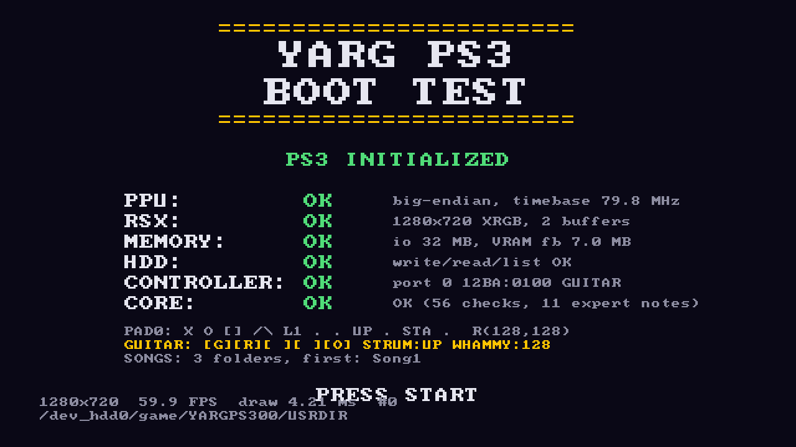

# YARG PS3

Natywny port gry rytmicznej opartej na [YARG](https://github.com/YARC-Official/YARG) / [YARG.Core](https://github.com/YARC-Official/YARG.Core) na PlayStation 3 (homebrew, PSL1GHT).

**Stan: Milestone 1 — YARG PS3 BOOT TEST, gotowy do pierwszego testu na konsoli/RPCS3.**



## Co jest w repozytorium

```
core/                    przenośny rdzeń C++17 (bez PS3, bez Unity)
  src/midi.cpp           czytnik plików .mid (SMF), odporny na uszkodzone pliki
  src/tempo.cpp          mapa tempa: tick <-> sekundy
  src/guitar_chart.cpp   chart 5-fret: nuty, akordy, sustainy, HOPO, tap, star power
  src/song_ini.cpp       song.ini (Clone Hero / YARG)
  src/selftest.cpp       deterministyczny self-test (uruchamiany też na PS3)
  tests/                 testy jednostkowe + fuzzing (ASan/UBSan)
  tools/chartdump.cpp    zrzut chartu do tekstu (porównanie z YARG.Core)
  tools/gen_corpus.cpp   generator losowych chartów testowych (granice progu HOPO itd.)
ps3/boot_test/           EBOOT milestone 1 (PSL1GHT)
  source/main.cpp        sprawdzenia PPU/RSX/MEMORY/HDD/CONTROLLER/CORE, pętla, wyjście
  source/display.cpp     framebuffer RSX (2 bufory, vsync)
  source/canvas.cpp      rysowanie CPU + font 8x8
  source/boot_screen.cpp układ ekranu (ten sam kod renderuje podgląd na PC)
  host_preview/          render ekranu do obrazka na PC
tools/golden_cs/         program C# na prawdziwym YARG.Core (wyrocznia)
tools/golden_compare.sh  porównanie C++ vs YARG.Core: 40 piosenek x 4 poziomy trudności
.github/workflows/       CI: testy, porównanie z YARG.Core, build EBOOT/PKG w chmurze GitHub
docs/AUDIT.md            audyt YARG -> PS3
```

Reguły chartu są przeniesione z YARG.Core (MoonscraperChartParser), m.in.: progi
HOPO `resolution/3 + 1`, odcięcie sustainów `resolution/3`, wyjątek akordu dla naturalnych HOPO,
wymuszone HOPO/strum (`base+5`/`base+6`), tap (104), star power (116), `ENHANCED_OPENS`.

## Zbudowanie bez instalowania czegokolwiek (GitHub Actions)

1. Załóż konto na github.com i nowe repozytorium (może być prywatne).
2. Wgraj zawartość tego folderu (np. przez „Add file → Upload files” albo `git push`).
3. Zakładka **Actions** → workflow **YARG PS3 build** uruchomi się sam.
4. Po zakończeniu otwórz przebieg i pobierz artefakt **yargps3-boot-test**
   (w środku `boot_test.pkg`, `boot_test.self`, `boot_test.fake.self`).
5. Artefakt **boot-screen-preview** zawiera podgląd ekranu z PC.
6. Job **golden-vs-yargcore** porównuje parser C++ z prawdziwym YARG.Core; przy różnicach
   artefakt **golden-report** zawiera pliki `.diff` (`-` = YARG.Core, `+` = port).

Workflow pobiera gotowe SDK `ps3dev` (toolchain PPU GCC 13.2 + PSL1GHT + ps3libraries)
z wydań repozytorium `ps3dev/ps3dev`, więc nic nie trzeba instalować lokalnie.

## Uruchomienie

- **RPCS3:** File → Install Packages/Raps/Edats → `boot_test.pkg`, potem uruchom z listy gier.
  Alternatywnie File → Boot (S)ELF → `boot_test.fake.self`.
- **PS3 (HEN/CFW):** skopiuj `boot_test.pkg` na pendrive (FAT32), zainstaluj przez
  Package Manager → Install Package Files. Ikona „YARG PS3 Boot Test” pojawi się w Game.

Dane programu: `/dev_hdd0/game/YARGPS300/USRDIR/` (`config/ scores/ cache/ songs/`).
Wrzuć tam do `songs/` kilka folderów z `notes.mid` + `song.ini`, a ekran pokaże ich liczbę.

## Co powinno się pokazać

```
========================
       YARG PS3
       BOOT TEST
========================
PS3 INITIALIZED
PPU: OK         big-endian, timebase ... MHz
RSX: OK         1280x720 XRGB, 2 buffers, vsync
MEMORY: OK      heap 64 MB ok, io 32 MB, fb 2x3.5 MB
HDD: OK         write ok, read ok, list ok
CONTROLLER: OK  1 connected, port 0 054C:0268
CORE: OK        OK (56 checks, 11 expert notes)
PRESS START
```

START (puszczenie przycisku) albo „Quit Game” z XMB kończy program bez restartu konsoli.
Log trafia do `USRDIR/boot_test.log`.

## Raport z testu (proszę odesłać)

1. Gdzie: RPCS3 (wersja) czy PS3 (model, HEN/CFW, firmware).
2. Zdjęcie/zrzut ekranu BOOT TEST.
3. Plik `boot_test.log`.
4. Jeśli masz gitarę: zdjęcie linii `GUITAR:` przy wciśniętych kolejnych fretach, strum góra/dół, whammy.
5. Czy wyjście START i z XMB działa bez zawieszenia.

## Znane problemy / niezweryfikowane

- **Kod PS3 nie był jeszcze kompilowany prawdziwym `ppu-g++`.** Został sprawdzony składniowo
  na nagłówkach PSL1GHT; prawdziwą weryfikacją jest pierwszy przebieg CI.
- **Porównanie z YARG.Core nie było jeszcze uruchomione** (brak .NET w środowisku, w którym
  powstał kod) — pierwszy przebieg jobu `golden-vs-yargcore` to pokaże.
- Nie przeniesiono jeszcze: otwartych nut i tapów z sysex Phase Shift, solówek, formatu `.chart`.
- Nazwa zasobu SDK w wydaniach `ps3dev/ps3dev` jest wywnioskowana z ich własnego workflow
  (`ps3dev-linux-X64.tar.gz`). Jeśli CI zgłosi brak pliku, trzeba poprawić krok „Download ps3dev SDK”.
- Mapowanie gitary (G=×, R=○, Y=□, B=△, O=L1, strum=d-pad, whammy=prawa gałka X) pochodzi
  z dokumentacji PlasticBand dla surowego HID; czy libpad podaje to identycznie — do sprawdzenia.
- Title ID to `YARGPS300` (9 znaków, jak zwykle na PS3), więc folder to `YARGPS300`, a nie `YARGPS3`.
- Ścieżka danych jest brana z `argv[0]`; jeśli nie wskazuje na `/dev_hdd0/game/`, używany jest
  `/dev_hdd0/game/YARGPS300/USRDIR`.
- Rysowanie odbywa się na CPU (PPU pisze do VRAM). To wystarczy na boot test; highway
  w milestone 6 pójdzie przez RSX.

## Rozwój lokalnie (opcjonalnie)

```bash
# rdzeń + testy na PC
cmake -S core -B core/build && cmake --build core/build && ctest --test-dir core/build

# PS3 (wymaga zainstalowanego ps3dev, PS3DEV/PSL1GHT w środowisku)
make -C ps3/boot_test && make -C ps3/boot_test pkg
```

## Licencja

LGPL-3.0-or-later (jak YARG i YARG.Core) — patrz `LICENSE` i `COPYING.GPL3`.
Kod i materiały zewnętrzne: `THIRD_PARTY.md`.
